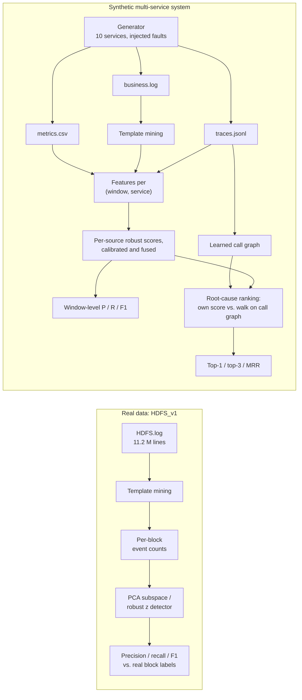

# log-fusion-anomaly-detection

Log parsing, multi-source fusion (call traces, business logs and metrics per service and time window),
statistical anomaly detection and graph-based root-cause ranking, evaluated on real HDFS logs and on a
synthetic multi-service system.

[](https://www.python.org/)
[](LICENSE)
[](https://github.com/yousefibehnam/log-fusion-anomaly-detection/actions/workflows/ci.yml)

## Background

Originally developed in 2017–2018 during my M.Sc. research.
This repository is a clean re-implementation written in 2026.

## Timeline

- **2017–2018:** original design and evaluation during my M.Sc. research
- **2026:** clean re-implementation (this repository)

## Features

- **Template mining.** An online parser turns raw log messages into event templates. It masks ids,
  addresses and numbers, then clusters messages by similarity within buckets of the same length and
  first word. On Loghub's hand-labelled HDFS sample its grouping accuracy is 0.9975, and it processes
  all 11.2 M HDFS_v1 lines in about 50 s on one core.
- **Statistical detectors.**
  - A PCA subspace detector: TF-IDF weighting, then the squared prediction error of each sample,
    compared with the Jackson–Mudholkar Q-statistic threshold.
  - A robust median/MAD z-score detector.
- **Three-source fusion.** Traces, business-log templates and metrics are aligned per *(window,
  service)*. Each source is scored, calibrated on fault-free windows, and the sources are fused on a
  common alarm scale.
- **Graph-based root-cause ranking.** The service call graph is learned from parent/child spans.
  Anomaly scores are then propagated with an anomaly-guided random walk that follows symptoms
  downstream to the deepest anomalous dependency. It is compared with ranking services by their own
  score.
- **Evaluation.**
  - Precision, recall, F1 and ROC AUC on the real HDFS block labels, plus a PCA protocol study.
  - Window-level precision, recall and F1 per source combination, and top-k accuracy and MRR for root
    causes, over 10 synthetic seeds.

## Method



**Parsing.** Each message is masked (block ids, IP:port, hex and plain numbers become
placeholders) and tokenised. Messages are compared only with templates of the same length and the
same first word. A message joins the most similar template when two conditions hold:

- at least 70% of its positions agree;
- every disagreement involves a variable-looking token, meaning a placeholder or a token containing a
  digit or `/`.

Disagreeing positions become wildcards. Two different plain words, such as `terminating` and
`Interrupted.`, therefore stay two events.

**HDFS detection.** Following Xu et al. (2009), all lines that mention a block form that block's
session, represented by its template counts. Blocks are ordered by their first line and split in
half. Detectors are fitted on the first half without labels and evaluated on the second half.

**Fusion.**

- **Features per (window, service):**
  - traces: calls, failed calls, mean and p95 latency;
  - logs: the count of each mined template;
  - metrics: CPU and memory.
- **Scoring:** per source and service, robust z-scores are fitted on the first 20% of windows, which
  are fault-free. A service's source score is its largest feature z-score.
- **Calibration:** each source is divided by the highest window score it reaches on the next 10% of
  windows (also fault-free), so 1.0 means "alarm" for every source.
- **Fusion:** the fused score of a service is the largest calibrated score over the selected sources.

**Root-cause ranking.** For each detected fault, service scores are averaged over its alarmed
windows. The random walk is built as follows:

- from service *u* it moves to a callee *v* with weight score(*v*);
- it moves back to a caller *c* with weight 0.2·score(*c*);
- it stays with weight max(0, score(*u*) − the highest callee score);
- it restarts in proportion to the scores, with damping 0.85.

Services are ranked by their stationary probability.

## Dataset

Dataset chosen to match the period of the original project (2017–2018).

**1. HDFS_v1 (real data): parsing and statistical detection.**

| | |
|---|---|
| Name | HDFS_v1, from the Loghub collection |
| Origin | Hadoop console logs from a private cloud running benchmark workloads, labelled per block by Xu et al. (SOSP 2009) |
| Size | 11,175,629 lines (1.47 GB unzipped); 575,061 blocks, of which 16,838 (2.93%) are anomalous |
| Source | https://zenodo.org/records/8196385 (`HDFS_v1.zip`, MD5 `76a24b4d9a6164d543fb275f89773260`) |
| License | Loghub license: *freely available for research or academic work*; any usage or distribution must refer to https://github.com/logpai/loghub and cite the Loghub paper, and the notice must accompany copies of the data |
| Download | `scripts/download_data.sh` (checks the MD5). The dataset is **not** committed |

A 2,000-line sample with hand-labelled events (`tests/data/loghub/HDFS_2k.log_structured.csv`, from
the Loghub repository) is committed together with Loghub's license notice. It is used to measure
parsing accuracy.

Citations:

- W. Xu, L. Huang, A. Fox, D. Patterson, M. I. Jordan. *Detecting Large-Scale System Problems by
  Mining Console Logs.* SOSP 2009.
- J. Zhu, S. He, P. He, J. Liu, M. R. Lyu. *Loghub: A Large Collection of System Log Datasets for
  AI-driven Log Analytics.* ISSRE 2023.

**2. Synthetic multi-service system: three-source fusion and root-cause ranking.**

> ⚠️ **All fusion and root-cause results below come from synthetic data.** I found no public
> dataset from 2018 or earlier that provides call traces, business logs and metrics for the same
> services together with labelled faults, so the data are produced by the generator in
> `src/logfusion/synthetic/` (MIT, part of this repository). Nothing generated is committed;
> `logfusion synthetic` regenerates it from the seeds.

The generator simulates a ten-service online shop. Each seed covers 720 one-minute windows with
Poisson request load on a two-hour cycle and 10 injected faults at random services. Faults start
only after the first 30% of windows. Each fault type shows up in different sources:

| Fault | Traces | Business logs | Metrics |
|---|---|---|---|
| `cpu` | root 2.5× slower | — | CPU +35–45 points |
| `memory` | root up to 30% slower | GC warnings | memory ramps up |
| `latency` | +150–250 ms at the root | callers log slow responses | — |
| `error` | root fails 35% of calls; callers fail in turn | ERROR lines at the root and at failing callers | — |

## Installation and usage

You need Python 3.12 or newer. To install and run the quick synthetic demo, with no download:

```bash
make demo
```

The full experiments:

```bash
make synthetic   # seeds 1-10 -> results/synthetic/   (about 25 s)
make hdfs        # downloads HDFS_v1 (187 MB), parses 11.2 M lines -> results/hdfs/   (about 1 min after download)
make test        # unit tests
```

Or run the steps yourself:

```bash
python3 -m venv .venv && .venv/bin/pip install -r requirements.txt && .venv/bin/pip install -e . --no-deps
.venv/bin/logfusion generate --seed 1 --out data/synthetic/seed1     # write one synthetic dataset
.venv/bin/logfusion synthetic --seeds 1-10
scripts/download_data.sh && .venv/bin/logfusion hdfs
```

Tested with Python 3.14.2 locally (the published results) and with 3.12 and 3.14 in CI.

## Results

Every number below was produced by the commands above. The full tables are in
[results/hdfs/hdfs_results.md](results/hdfs/hdfs_results.md) and
[results/synthetic/summary.md](results/synthetic/summary.md).

### HDFS_v1 (real data)

**Parsing.** 11,175,629 lines and 54 templates, in 52 s on one process. Grouping accuracy on the
hand-labelled HDFS_2k sample is **0.9975** (16 templates against 14 true events).

**Detection (main, pre-declared protocol).** The models are fitted without labels on the first half
of the blocks (287,530 blocks, 10,170 of them anomalous) and evaluated on the second half (287,531
blocks, 6,668 anomalous).

| Detector | Precision | Recall | F1 | ROC AUC |
|---|---:|---:|---:|---:|
| PCA (TF-IDF, 95% variance, α = 0.001) | 0.616 | 0.084 | 0.148 | 0.689 |
| PCA (raw counts, 95% variance, α = 0.001) | 0.010 | 0.148 | 0.018 | 0.655 |
| Robust z-score (max \|z\| > 3.5) | 0.100 | 0.006 | 0.011 | 0.712 |

**PCA protocol study.** Each cell gives precision / recall / **F1** for the two feature sets.

| Protocol | This parser's templates | Loghub's 29 reference events |
|---|---:|---:|
| Unsupervised, temporal split, 90% variance | 0.997 / 0.682 / **0.810** | 0.997 / 0.682 / **0.810** |
| Unsupervised, temporal split, 95% variance (main) | 0.616 / 0.084 / **0.148** | 0.993 / 0.274 / **0.429** |
| Unsupervised, temporal split, 99% variance | 0.095 / 0.026 / **0.041** | 0.991 / 0.205 / **0.340** |
| Unsupervised, fit and evaluate on all blocks | 0.975 / 0.637 / **0.770** | 0.975 / 0.636 / **0.770** |
| Semi-supervised (fit on normal training blocks) | 0.707 / 0.598 / **0.648** | 0.707 / 0.598 / **0.648** |

What the HDFS results show:

- **The parser performs as well as the reference templates.** It gives identical results under four
  of the five protocols. The protocol of earlier studies (fit and evaluate on all blocks) gives
  P 0.975 / R 0.637, close to the P 0.98 / R 0.67 reported for PCA on HDFS by He et al. (ISSRE 2016).
- **PCA is fragile under a realistic temporal split.** F1 is 0.810 with 4 components and 0.148 with 7.
  The training half contains anomalies (it is unsupervised), and the extra components absorb
  anomaly directions, so test anomalies then look "normal". This parser keeps rare exception
  messages as separate templates. TF-IDF weights those heavily, which is the likely reason the effect
  is stronger than with the coarser reference events. The main row reports the configuration
  declared in advance; it is not the best one.
- **Per-feature z-scores do not work on HDFS.** All 54 template counts have zero MAD on the
  training half, so the scale falls back to the floor of 1. Many anomalies are probably defined by
  *combinations* of events rather than by one unusual count.

### Synthetic multi-service system (synthetic data, seeds 1–10)

Seed 0 was used while developing the generator (it led to the two-hour load cycle) and is excluded.
The values are the mean ± standard deviation over 10 seeds, on test windows (the last 70%).

| Sources | Precision | Recall | F1 |
|---|---:|---:|---:|
| traces | 0.929 ± 0.093 | 0.480 ± 0.171 | 0.605 ± 0.150 |
| logs | 0.927 ± 0.055 | 0.302 ± 0.092 | 0.446 ± 0.105 |
| metrics | 0.923 ± 0.049 | 0.581 ± 0.058 | 0.711 ± 0.046 |
| traces + logs | 0.892 ± 0.104 | 0.492 ± 0.162 | 0.608 ± 0.131 |
| traces + metrics | 0.901 ± 0.073 | 0.860 ± 0.081 | 0.875 ± 0.043 |
| logs + metrics | 0.921 ± 0.034 | 0.857 ± 0.087 | 0.885 ± 0.050 |
| **traces + logs + metrics** | 0.881 ± 0.077 | 0.872 ± 0.076 | **0.871 ± 0.041** |

**Recall by fault type** (the share of fault windows detected):

| Sources | cpu | memory | latency | error |
|---|---:|---:|---:|---:|
| traces | 0.622 | 0.031 | 1.000 | 0.434 |
| logs | 0.088 | 0.000 | 0.947 | 0.474 |
| metrics | 1.000 | 0.940 | 0.006 | 0.007 |
| traces + logs + metrics | 1.000 | 0.945 | 1.000 | 0.491 |

**Root-cause ranking.** 96 of the 100 injected faults were detected, and 10 services are ranked
(random top-1 = 0.10).

| Method | Top-1 | Top-3 | MRR |
|---|---:|---:|---:|
| Own anomaly score | 0.958 | 0.979 | 0.973 |
| Anomaly-guided walk on the learned call graph | 0.958 | 0.979 | 0.972 |

What the synthetic results show:

- **Fusion helps most when the sources are complementary.** Metrics see CPU and memory faults, while
  traces and logs see latency faults, so combining metrics with either of them raises F1 from
  0.45–0.71 to 0.87–0.89. Adding a third source does not improve F1 further: max-fusion adds
  recall but also each source's false alarms.
- **Error faults are the hardest** (recall about 0.49 with all sources). At a 35% failure rate and
  about 30 requests per minute, many windows show only a handful of failures.
- **The graph walk did not beat the simpler ranking on this generator.** Per-service robust scoring
  already puts the root first in 95.8% of detected faults. Presumably this is because callers'
  symptoms are small relative to their own normal variability. The unit test `tests/test_rootcause.py` shows the case the walk
  is designed for, where callers look more anomalous than the root. That case did not occur often
  enough here to make a difference.

## Project structure

```
log-fusion-anomaly-detection/
├── Makefile                     install / test / lint / demo / synthetic / hdfs
├── pyproject.toml, requirements.txt
├── scripts/download_data.sh     HDFS_v1 from Zenodo, MD5-checked
├── results/
│   ├── hdfs/                    hdfs_results.{md,json}
│   └── synthetic/               summary.{md,json}, runs.json (per seed and per fault)
├── src/logfusion/
│   ├── parsing/                 masking.py, miner.py (template mining)
│   ├── hdfs.py                  HDFS_v1 lines -> per-block event counts
│   ├── detectors/               pca.py, robust.py, rootcause.py
│   ├── synthetic/               topology.py, generator.py (SYNTHETIC data)
│   ├── fusion/                  sources.py (load and align three sources), detector.py
│   ├── experiments/             hdfs.py, synthetic.py
│   ├── evaluation.py            P/R/F1, top-k, MRR, grouping accuracy
│   └── cli.py                   logfusion {generate, synthetic, hdfs}
└── tests/                       unit tests and data/loghub/ (HDFS_2k sample with license notice)
```

## Limitations and future work

- **Synthetic fusion data.** The fusion and root-cause results only show how the methods behave
  under the generator's assumptions. They are not evidence about real systems. Real multi-source
  datasets released after 2018 would be the natural next test.
- **Choices made after looking at data.** The parser threshold was checked on the HDFS_2k sample
  (accuracy is the same from 0.5 to 0.7). The plain-word rule was added after comparing the
  full-data templates with the reference events. The generator's load cycle was changed after
  looking at seed 0, which is therefore excluded from the results.
- **PCA component selection.** The number of components is chosen by explained variance, and this
  choice dominates the results under the temporal split. A label-free way to choose it would be
  worth studying.
- **Fusion rule.** Max-fusion with per-source calibration is simple and adds every source's false
  alarms. Weighted or learned fusion could keep the recall gain with fewer false positives.
- **Root-cause ranking** was evaluated only on faults the detector caught, with averaged window
  scores. Harder propagation scenarios (fan-in, retries, timeouts) would test the graph walk better.
- **Evaluation** is window-level, without point-adjustment, and parsing runs in a single process.

## License

MIT. See [LICENSE](LICENSE). The HDFS_2k sample in `tests/data/loghub/` is distributed under
Loghub's own license notice, which is included next to it.
